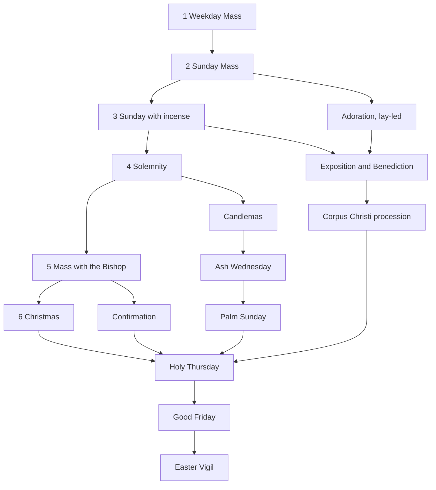

# Development guide and resume checklist

Read this first when starting a new session, human or AI. It explains how to
pick up the work, the current status, and the steps each change goes through.
What the product must do is specified in [`SPEC.md`](SPEC.md).

## Start-of-session checklist

- [ ] Read `docs/SPEC.md`, then this file, then the last round in
      `docs/GAME-DECISIONS.md`. The next decision number is in
      [Status](#status).
- [ ] Run `git fetch` and check open PRs (`gh pr list`) and issues
      (`gh issue list`). Merge `origin/main` into your branch if it moved.
- [ ] Run the four tests (below) to confirm a green baseline before editing.
- [ ] Note the user's request verbatim. Record any interpretation of an
      ambiguous request as a decision.
- [ ] For liturgical or Catholic questions, consult the Magisterium MCP server
      before relying on a claim; cite its supporting sources and ask the user
      when they do not resolve an ambiguity.

## Per-change checklist

- [ ] Put pure rules in `mass-game-logic.js`, export them through
      `module.exports`, and test them in `mass-game.test.cjs`.
- [ ] For a new script, add its `<script>` tag in the right order and a
      `node --check` line in `.github/workflows/checks.yml`.
- [ ] Put any markup a script needs at startup **before** the script tags.
- [ ] When setup defaults change, bump `SETUP_VERSION` in `mass-game.js` and
      decide how older saves migrate.
- [ ] Run the tests:
      ```
      node mass-scenarios.test.cjs
      node mass-features.test.cjs
      node mass-assets.test.cjs
      node mass-game.test.cjs
      ```
- [ ] Play it through in a real browser via `file://`: no console errors, and
      the new behaviour seen working. Automated checks used puppeteer-core
      with Edge (headless) and screenshots; such harness scripts are not
      committed.
- [ ] Log decisions in `docs/GAME-DECISIONS.md` (`R<n>`: question, choice,
      alternatives, source). Cite GIRM paragraphs through magisterium.com
      links.
- [ ] Make changes on a topic branch and submit them through a pull request.
      Never commit directly to `main`; confirm CI is green on the PR.
- [ ] Update the README ("Play now" for players, the game section for
      details) and `docs/SOURCES.md` if sources changed.
- [ ] When committing on the topic branch, use the trailer
      `Co-authored-by: Copilot App <223556219+Copilot@users.noreply.github.com>`,
      then push and open the pull request.
- [ ] Update [Status](#status) below.

## Conventions and pitfalls

- Files are UTF-8 without BOM, with LF line endings (`.gitattributes`
  normalises them). On Windows, write files with
  `[IO.File]::WriteAllText(path, text, (New-Object Text.UTF8Encoding $false))`.
- Scripts are classic and share globals, so avoid accidental name clashes
  across files.
- `material()` in `mass-3d.js` is cached and shared. Clone a material before
  changing it per mesh.
- `mass-materials.js` applies finishes only to explicitly tagged meshes.
  Pass the optional surface kind to `box`/`cylinder`, or use `finishSurface`.
  Supply a new base material to `finishSurface` when changing a surface colour.
  Do not mutate cached textures or infer a finish from a colour. Texture
  providers are High-only and should return a cleanup function.
- Plan coordinates convert to world coordinates with `world([x,y])`
  (SCALE .025; plan x 500 is world 0).
- `mass-3d.css` styles `header span`. Panels placed inside the header must
  reset `color` and `font-size`.
- Audio pipeline: `prepare-audio.cjs`, then `generate-audio.py`, then
  `snapshot-audio.cjs`, which writes `audio/audio-manifest.js` and
  `audio/index.csv`. The README section "Pre-generated AI audio" has the
  details, and `mass-assets.test.cjs` checks the references.
- Never reproduce full copyrighted liturgical texts (SPEC C3).
- Don't stop desktop applications you did not start without asking the user.

## Status

The repository is `jddcef/mass-sim-liturgy`, renamed from
`roman-mass-explorer`. GitHub Pages serves `main` at
<https://jddcef.github.io/mass-sim-liturgy/>. Contributions use topic branches
and pull requests; do not commit directly to `main`. Consult the Magisterium MCP
server for liturgical or Catholic questions and clarifications.

**Next decision number: R98.**

| Round | PR | Content |
|---|---|---|
| 1 | #2 | Playable simulator: roles, four levels, options, lapses, M.C., sacristan, bells and thurible |
| 2–3 | #3 | Watch mode, symbols, varied heights, incensation detail, cross and crucifix placement, outfits, liturgical colours, redo, windows and floor |
| 4 | #4 | Recorded audio in the game, homily place, collection, EMHC, reserved hosts, readers, timeline jump, speed slider |
| 5 | #5 | Role card, side quests, camera pad, speaker view, highlight, first person, sacristan training, audio fixes |
| 6 | #6 | Cupboard models, vestment rail and stand, first-person views, figure eyes |
| 7 | #7 | Presets, role switching, screen operator, monstrance, detail levels, sound icon, cancel New game |
| 8 | #8 | Search and index card, hover tips, feedback, wall fade, nave seating, audio timing, rename |
| docs | #8 | Player-facing README opening, `SPEC.md`, this guide, Copilot instructions |
| 9 | (this PR) | More natural bell synthesis, compact phone layout with fold-away menus |
| 10 | local, not published | Offline stone/marble/wood textures and metal finishes on Standard/High, reversible detail switching, restrained lighting; existing defaults and saved choices retained |
| 11 | local, not published | Repository workflow guidance: changes go through PRs rather than direct commits to `main`; consult the Magisterium MCP for liturgical and Catholic questions |
| 12 | local, not published | The Path and seniority: Involvement rename, Sunday split into with and without incense, a liturgical-year map of celebrations with marks and ranks, roadmap of rites "in preparation" |

Round 10 was exercised in Edge through `file://` on all three pages, including
all sanctuary floors, repeated quality switches, layouts, appearance changes,
wall fading, first-person material clones and a complete accelerated Sacristan
Watch run (opening, setup, Mass and pack-away). Browser checks reported no
console errors or external requests; texture/material counts stayed constant
after warming and repeating the quality/floor combinations. This is not a
performance claim for physical low-spec hardware. Simulated low-memory mobile
startup selected Auto/Low and created no surface textures, finish-material
variants or reflection environment. All script syntax checks and all four
Node suites pass on Node 22. No commit, push or PR was requested, so remote CI
has not been run for this change.

Round 12 was exercised in Edge headless through `file://`: the Path opens
from setup and from the summary, "Prepare this celebration" sets the preset,
a credited game updates the mark, the rank strip and the recommendation, Esc
closes the Path, and at 390 px the list replaces the map. No console errors.
All four Node suites pass. Not committed or pushed.

### Open items and backlog

- [ ] Issue #1: regenerate the congregation audio with the four-voice mix.
- [ ] Owner: create a Formspree or Basin form and set `FEEDBACK_ENDPOINT` in
      `feedback-config.js`.
- [ ] Owner review of judgement calls in `GAME-DECISIONS.md`, especially
      R77 (reading of "nave without side aisles").
- [ ] Latin audio pack is partial.
- [ ] Roadmap for the Path (R96, R97). The celebrations are already on the map
      as "In preparation"; adding a `preset` to a celebration in
      `CELEBRATIONS` makes it playable and creditable.
      1. Rite registry: replace the single `STEPS` list in `mass-rite.js` with
         rites selected by the setup, so non-Mass rites can run.
      2. Exposition and Benediction: lay-led Adoration (expose and repose,
         no blessing) and the clergy form (cope, humeral veil, incense,
         monstrance blessing). The monstrance is already in the cupboard.
      3. Mass with the Bishop: mitre- and crozier-bearers in vimps, book and
         bugia, chaplain; then Confirmation.
      4. Christmas Mass, Candlemas, Ash Wednesday, Palm Sunday.
      5. Corpus Christi: an outdoor procession (canopy, torches, petals,
         Benediction at altars), which needs an outdoor scene.
      6. The Triduum: Holy Thursday, Good Friday, the Easter Vigil.
      7. Later: Vespers with Benediction, funerals, weddings, baptism.


- [x] Local surface textures on Standard and High (round 10); Low stays
      untextured and the High-only extension hook remains available.
- [ ] Future: a full first-person mode for every role, extending today's
      first person with hints.
