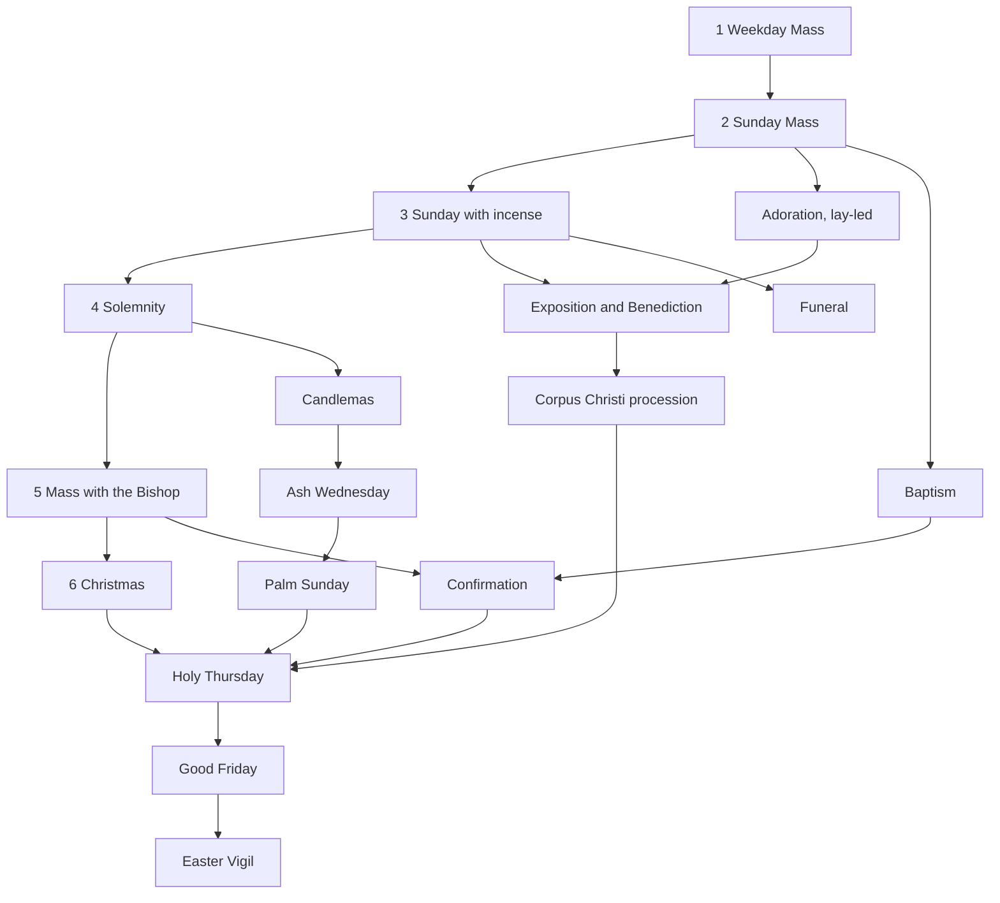

# Development guide and resume checklist

Read this first when starting a new session, human or AI. It explains how to
pick up the work, the current status, and the steps each change goes through.
What the product must do is specified in [`SPEC.md`](SPEC.md).

## Start-of-session checklist

- [ ] Read `docs/SPEC.md`, then this file, then the last round in
      `docs/GAME-DECISIONS.md`. The next decision number is in
      [Status](#status).
- [ ] Run `git fetch` and check open PRs (`gh pr list`) and issues
      (`gh issue list`). Merge `origin/main` into your branch if it moved.
- [ ] Run the six tests (below) to confirm a green baseline before editing.
- [ ] Note the user's request verbatim. Record any interpretation of an
      ambiguous request as a decision.
- [ ] For liturgical or Catholic questions, consult the Magisterium MCP server
      before relying on a claim; cite its supporting sources and ask the user
      when they do not resolve an ambiguity.

## Per-change checklist

- [ ] Put pure rules in `mass-game-logic.js`, export them through
      `module.exports`, and test them in `mass-game.test.cjs`.
- [ ] For a new script, add its `<script>` tag in the right order and a
      `node --check` line in `.github/workflows/checks.yml`.
- [ ] Put any markup a script needs at startup **before** the script tags.
- [ ] When setup defaults change, bump `SETUP_VERSION` in `mass-game.js` and
      decide how older saves migrate.
- [ ] Run the tests:
      ```
      node mass-scenarios.test.cjs
      node mass-features.test.cjs
      node mass-assets.test.cjs
      node mass-game.test.cjs
      node mass-corpus.test.cjs
      node mass-people.test.cjs
      ```
- [ ] Play it through in a real browser via `file://`: no console errors, and
      the new behaviour seen working. Automated checks used puppeteer-core
      with Edge (headless) and screenshots; such harness scripts are not
      committed.
- [ ] Log decisions in `docs/GAME-DECISIONS.md` (`R<n>`: question, choice,
      alternatives, source). Cite GIRM paragraphs through magisterium.com
      links.
- [ ] Make changes on a topic branch and submit them through a pull request.
      Never commit directly to `main`; confirm CI is green on the PR.
- [ ] Update the README ("Play now" for players, the game section for
      details) and `docs/SOURCES.md` if sources changed.
- [ ] When committing on the topic branch, use the trailer
      `Co-authored-by: Copilot App <223556219+Copilot@users.noreply.github.com>`,
      then push and open the pull request.
- [ ] Update [Status](#status) below.

## Conventions and pitfalls

- Files are UTF-8 without BOM, with LF line endings (`.gitattributes`
  normalises them). On Windows, write files with
  `[IO.File]::WriteAllText(path, text, (New-Object Text.UTF8Encoding $false))`.
- Scripts are classic and share globals, so avoid accidental name clashes
  across files.
- `material()` in `mass-3d.js` is cached and shared. Clone a material before
  changing it per mesh.
- `mass-materials.js` applies finishes only to explicitly tagged meshes.
  Pass the optional surface kind to `box`/`cylinder`, or use `finishSurface`.
  Supply a new base material to `finishSurface` when changing a surface colour.
  Do not mutate cached textures or infer a finish from a colour. Texture
  providers run at High and above and should return a cleanup function.
- `mass-realism.js` (Ultra and above) finds light sources by the
  `userData.glow` tag set by `markGlow` in `mass-3d.js`. Call
  `SceneRealism.refresh({probe:true})` after changing the church so lights and
  reflections follow. The render callback returns the share of the church left
  visible (`gameRender` returns 0.38 in highlight mode); labels are drawn after
  post-processing and fade by it.
- Plan coordinates convert to world coordinates with `world([x,y])`
  (SCALE .025; plan x 500 is world 0).
- `mass-3d.css` styles `header span`. Panels placed inside the header must
  reset `color` and `font-size`.
- Audio pipeline: `prepare-audio.cjs`, then `generate-audio.py`, then
  `snapshot-audio.cjs`, which writes `audio/audio-manifest.js` and
  `audio/index.csv`. The README section "Pre-generated AI audio" has the
  details, and `mass-assets.test.cjs` checks the references.
- Never reproduce full copyrighted liturgical texts (SPEC C3).
- Don't stop desktop applications you did not start without asking the user.

## Status

The repository is `jddcef/mass-sim-liturgy`, renamed from
`roman-mass-explorer`. GitHub Pages serves `main` at
<https://jddcef.github.io/mass-sim-liturgy/>. Contributions use topic branches
and pull requests; do not commit directly to `main`. Consult the Magisterium MCP
server for liturgical or Catholic questions and clarifications.

**Next decision number: R246.**

| Round | PR | Content |
|---|---|---|
| 1 | #2 | Playable simulator: roles, four levels, options, lapses, M.C., sacristan, bells and thurible |
| 2–3 | #3 | Watch mode, symbols, varied heights, incensation detail, cross and crucifix placement, outfits, liturgical colours, redo, windows and floor |
| 4 | #4 | Recorded audio in the game, homily place, collection, EMHC, reserved hosts, readers, timeline jump, speed slider |
| 5 | #5 | Role card, side quests, camera pad, speaker view, highlight, first person, sacristan training, audio fixes |
| 6 | #6 | Cupboard models, vestment rail and stand, first-person views, figure eyes |
| 7 | #7 | Presets, role switching, screen operator, monstrance, detail levels, sound icon, cancel New game |
| 8 | #8 | Search and index card, hover tips, feedback, wall fade, nave seating, audio timing, rename |
| docs | #8 | Player-facing README opening, `SPEC.md`, this guide, Copilot instructions |
| 9 | (this PR) | More natural bell synthesis, compact phone layout with fold-away menus |
| 10 | local, not published | Offline stone/marble/wood textures and metal finishes on Standard/High, reversible detail switching, restrained lighting; existing defaults and saved choices retained |
| 11 | local, not published | Repository workflow guidance: changes go through PRs rather than direct commits to `main`; consult the Magisterium MCP for liturgical and Catholic questions |
| 12 | local, not published | The Path and seniority: Involvement rename, Sunday split into with and without incense, a liturgical-year map of celebrations with marks and ranks, roadmap of rites "in preparation" |
| 27 | #21 | Good Friday (Celebration of the Passion of the Lord): silent entrance and prostration before bare altar; Collect without *Oremus*; Passion of St John in parts; ten Solemn Intercessions; Showing and Adoration of the Holy Cross (*Ecce lignum Crucis*); Communion from reserved Sacrament; Prayer over the People; silent departure; no Gloria, Creed, bells, or Eucharistic Prayer (R195–R201) |
| 28 | local, not published | Speaker-perspective look-around via drag and camera pad; continuous collection route joining the offertory presentation while keeping collection away from altar (R202–R203) |
| 29 | #24 (merged) | Corpus Christi outside-Mass procession with outdoor route, optional local-custom canopy/lights/stations, Benediction and reposition (R204) |
| 30 | #25 (merged) | Completion-based milestones and 1-3 performance stars; owner confirms R77 aisle layout and R17 calendar (R205-R207) |
| 31 | #26 (merged) | Persistent mini-game ideas and status backlog, including thurible timing and candle-lighting games (R208) |
| 32 | [#27](https://github.com/jddcef/mass-sim-liturgy/pull/27) (merged) | Practice room MG01-MG03: scene finding, selected cupboard preparation and procession arrangement; separate completion/stars records; standalone explorer compatibility fix (R209-R212) |
| 33 | [#28](https://github.com/jddcef/mass-sim-liturgy/pull/28) (merged) | MG10 abstract thurible rhythm/direction; MG11 symbolic lighter balance/reach ending at Easter Candle; MG12 abstract charcoal glow/pulse puzzle. Standard, Slow and untimed Assisted controls, isolated practice records and completion without score gates. MG04-MG09 remain Idea (R213-R216). |
| 34 | #23 | Three optional start-menu previews: grouped card stacks, dashboard and step-by-step setup; original remains the default at this stage, with shared controls and collapsed advanced settings (R217-R219) |
| 35 | #23 | Card stacks selected as default; illustrated involvement, challenge/assistance grouping, contextual celebration switches and season-tinted celebration browsing (R220-R223) |
| 36 | [#29](https://github.com/jddcef/mass-sim-liturgy/pull/29) (not yet merged) | Visual MG02 cupboard/furnishing preparation board; MG06 illustrated bounded pre-Mass inspection with correct scenes; directly visible Mini-games entry and exact prior-context return (R226-R228). |
| 37 | [#30](https://github.com/jddcef/mass-sim-liturgy/pull/30) (not yet merged) | Ultra, Realistic and Cinematic detail levels: detailed materials, church reflections and glow; candlelight, light shafts and hand-written HDR post-processing; supersampling. Offline, with WebGL 1 and shader fallbacks; Auto unchanged (R229-R234). |
| 38 | [#30](https://github.com/jddcef/mass-sim-liturgy/pull/30) (not yet merged) | Add Simple, Natural, Detailed and Lifelike people tiers with deterministic variation, procedural vestments and hair, skinned figures, hand props and two-bone arm IK; Auto follows graphics Detail while an optional override remains independent. Offline and progressively more expensive (R235-R238). |
| 40 | (this PR) | Highlight fade cleared by camera/scene input and restored after 5 s idle; sanctuary lamp mountings (hanging, wall bracket, stand, tabernacle), four styles with per-game Auto, placement by the layout editor; optional chancel arch with side walls and open front corners (R242-R245). |
| 39 | [#30](https://github.com/jddcef/mass-sim-liturgy/pull/30) (merged) | Detail-based 20/50/75/100% congregation budgets, no hidden-member animation or scene traversal, Blocks as the cheapest People tier and Low's Auto choice, and a one-click measured recommendation for both settings with exact game-clock/view restoration and explicit apply (R239-R241). |
| merge | #23 | Merge latest main, preserving Corpus Christi, completion milestones and Practice room; integrate Corpus choices into the contextual menu (R224) |
| 26 | #21 | Holy Thursday (Evening Mass of the Lord's Supper): Gloria with bells followed by liturgical silence; Mandatum (washing of the feet); Creed strictly omitted; EP I Roman Canon with proper Communicantes, Hanc igitur, and Qui pridie; no consecration bells; transfer of the Blessed Sacrament to Altar of Repose with humeral veil and Pange Lingua; stripping of the altar (Denudatio altaris) in silence without final blessing or dismissal (R188–R194) |
| 25 | local, not published | Liturgical Season Ribbon & Mini-Breviary sheet (feast rank, Latin vestment colours with GIRM 346 rationales, Ordo Missae and rubrics), and Visual Chime & Thurible Ripples on HUD and 3D floor (R182–R187) |
| 24 | #21 | Palm Sunday: blessing of palms at the back of the church, procession with palm branches, no Penitential Act or Gloria; the Passion read in parts at the ambo without candles or incense; all genuflect at the death of the Lord; Creed is said (R175–R181) |
| 23 | #20 | Funerals: the Funeral Mass (reception of the body at the door with holy water and the white pall, violet, no Gloria or Creed, final commendation with incense and the Song of Farewell, "In paradisum") and the funeral liturgy outside Mass with the Priest or the Deacon; coffin on a bier, paschal candle, holy-water stand; new Path branch "The rites for the dead" (R168–R174) |
| 22 | #18 | Baptism of children within Sunday Mass (reception at the door, rite at the font after the Homily, Solemn Blessing) and outside Mass with the Priest or the Deacon; font, paschal candle, oils, white garment and candle; new Path branch "Christian initiation" (R161–R167) |
| 21 | #17 | Ash Wednesday: no Penitential Act, Gloria, Creed or Alleluia; after the Homily the Priest blesses and sprinkles the ashes and gives them to the faithful, who come forward in a line; the Deacon or a server holds the vessel (R154–R160) |
| 20 | #16 | Candlemas: blessing of candles at the back of the church, procession with lighted candles and the Canticle of Simeon, no Penitential Act, candles out at the Gloria (R147–R153) |
| 19 | #15 | Christmas Mass during the Night: the Christmas Proclamation before Mass, all genuflect at the Incarnation, the crib in the nave blessed at the universal prayer, Christmas solemn blessing; the M.C. rank becomes reachable (R137–R146) |
| 18 | #14 | Confirmation within Mass: candidate and sponsor, presentation, renewal of promises, laying on of hands, anointing with chrism, no Creed, Confirmation blessing (R127–R136) |
| 17 | #13 | Mass with the Bishop: mitre- and crozier-bearers in vimps, mitre and pastoral staff in 3D, homily at the cathedra, pontifical blessing (R119–R126) |
| 16 | #12 | Exposition and Benediction by a Deacon; white cope and humeral veil in 3D (R115–R118) |
| 14 | #10 | Rite registry; lay-led Adoration and Exposition and Benediction with the Priest (R104–R110) |
| 13 | local, not published | Generic prepared-shell parish profiles and maintainer editor: local library/draft, plan and 3D route preview, full-profile JSON export/import, seating/target integration and simple exterior; future user patch workflow reserved |
| 15 | local, not published | Parish source intake: agent runbook, `parishes/` manifest and spec formats, Street View screening, draft profiles, offline bulk reviewer (R111–R114) |

Round 40 was exercised in Edge through `file://`. All four lamp mountings and
styles were rendered on both open and chancel sanctuaries, and screenshots were
inspected. Auto gave different styles for consecutive games. On the game page,
the Highlight fade was cleared by wheel input and the camera pad, returned
gradually after 5 s, and stayed when a question was answered. No console
errors were observed. A scenario test samples about 1.5 million minister walks
against the chancel walls. Moving the lamp in the layout editor changed Lamp
position to Custom and saved it. The editor now accepts a wall-mounted tabernacle
at depth 30–34. Before this fix, a tabernacle placed by the Tabernacle option
blocked every layout save.

Round 39 was exercised in isolated Edge through `file://` at 1280x900 and
390x844 on both 3D pages. Checks cover exact density budgets, detached omitted
roots, zero hidden-member pose calls, retained player, Blocks rendering,
real whole-church measurements even before Mass, unchanged stored choices
until explicit apply, cancellation, hidden-tab/resize cancellation, playback
resume, camera mode/first-person preservation and exclusion of check time from
answers. Screenshots of Blocks and mobile performance controls were inspected.
All six Node suites and the 28 CI-listed syntax checks pass locally on Node
26.7.0; CI executes the same checks on Node 22. No console errors or external
page requests were observed. No physical low-spec device was tested. The check
is a conservative sequence of combinations, not an exhaustive optimizer or a
hardware score; viewport, display frame-rate caps and fixed-until-reload
antialiasing affect results.

Round 38 was exercised in Edge through `file://`: the Natural-tier render shows
varied figures, hair and clothing. Both `mass-3d.html` and `mass-game.html`
load the People API and selectors without console errors or external requests.
Pose tests cover blessings, the Sign of the Cross, raised arms and altar
extensions, checking joint transforms for finite values. All six Node suites,
the 28 CI-listed `node --check` commands and `git diff --check` pass locally on
Node 26.7.0; PR CI also passed on Node 22. No physical
low-spec device was tested.

Round 36 was exercised in a self-closing isolated Edge instance through
`file://` at 1280x900 and 390x844, with 138 browser assertions and no page
errors or external page requests. The checks covered all four setup layouts,
native mouse dragging, keyboard placement/recovery, emulated-touch placement,
all four MG02 arrangements at three stars, board reset/replay, six-scene MG06
completion including correct scenes and incorrect keyboard inspection,
optional hints, low-score completion, best-star retention, reload and explicit
storage-write denial. Existing MG01/MG03 and MG10-MG12 controls/completion,
exact first-person camera restoration, answer-time exclusion, resumable setup,
and pausing/resuming an actually playing Watch Mass were also checked.
Both shared pages loaded without errors. All five Node suites, every
CI-listed syntax check and `git diff --check` pass locally (Node 26); CI uses
Node 22. Screenshots of actual boards, placed objects, correct inspection
scenes and direct-return UI were inspected and retained as session artifacts.
No physical phone, screen reader or low-spec hardware was tested. MG06 does
not assess missed cues or special rites; mobile boards scroll within their
scene area. The existing MG10-MG12 abstractions were not visually overhauled.
MG06 and the MG02 visual upgrade remain unmerged.

Round 33 was exercised in an isolated headless Edge instance through `file://`
at 1280x900 (keyboard) and 390x844 (emulated touch). All three hands-on games
were completed in Assisted mode on both viewports; Standard/Slow marker
animation, manual timing freeze, reset/replay with retained assistance, skips,
early completion, best-star retention, reload, the existing MG01 scene markers,
explicit storage-write failure, all existing save-key isolation and an unfinished
Priest game/camera resume were checked. The animation and standalone 3D pages
also loaded without console errors or external page requests. All five Node
suites and every CI-listed script syntax check pass locally (Node 26); PR CI
uses Node 22. No physical low-spec device, screen-reader software, or real flame
was used; symbolic games are not practical fire-handling instruction.

Round 10 was exercised in Edge through `file://` on all three pages, including
all sanctuary floors, repeated quality switches, layouts, appearance changes,
wall fading, first-person material clones and a complete accelerated Sacristan
Watch run (opening, setup, Mass and pack-away). Browser checks reported no
console errors or external requests; texture/material counts stayed constant
after warming and repeating the quality/floor combinations. This is not a
performance claim for physical low-spec hardware. Simulated low-memory mobile
startup selected Auto/Low and created no surface textures, finish-material
variants or reflection environment. All script syntax checks and all four
Node suites pass on Node 22. No commit, push or PR was requested, so remote CI
has not been run for this change.

Round 12 was exercised in Edge headless through `file://`: the Path opens
from setup and from the summary, "Prepare this celebration" sets the preset,
a credited game updates the mark, the rank strip and the recommendation, Esc
closes the Path, and at 390 px the list replaces the map. No console errors.
All four Node suites pass. Not committed or pushed.

Round 13 keeps the Legacy layout as the initial default and does not change
existing setup, layout, score or Path storage keys. `mass-parishes.js` supplies
pure profile validation, reversible seating coordinates and nave aisle routing;
`mass-parish-editor.js` supplies maintainer authoring on both 3D pages. Profiles
are strict versioned data for the fixed `rectangular-v1` shell, not arbitrary
surveyed churches. `bundled` in `mass-parishes.js` is the maintainer-reviewed
published profile list. New photographic/model assets require separate
preparation and rights review.

File-protocol browser checks in an isolated, self-exiting headless Edge instance
covered draft preview/cancel, furniture and seating mapping, the exterior and
animated route marker, working-copy persistence, full-profile export shape and
import, rejected unsupported/oversize files, explicit storage failures,
multiple-church selection, reload, Low/Standard/High switching, shifted-door
placement, expert picking for a moved ambo, editing guards, phone-width layout
and a complete accelerated Sacristan Watch run including opening and pack-away.
The browser harness advanced the Mass clock through its normal stop limits and
rendered walkers explicitly to avoid virtual-time frame throttling. Expected
validation/storage errors were checked separately; there were no unexpected
console errors or external page requests. All four Node suites and script
syntax checks pass. Direct `file://` startup also passed without a file-access
override; a cold Low startup created no surface textures with the profile shell
enabled. There is no physical low-spec performance claim, and no
real parish has yet been surveyed or recreated. Changes are local and
uncommitted; no push, PR or remote CI run was requested.

Round 15 adds parish source intake (R111–R114). `docs/PARISH-INTAKE.md` is a
runbook for an agent that prepares per-parish folders under `parishes/`, made
up of a source manifest with statuses and reason codes, and a parish spec with
per-value source and confidence. The agent screens Street View images with a
bearing rule and a visual check, and builds a review queue. `parish-intake.cjs`
(using `parish-intake.js`) provides the template, check, aim, draft, index and
apply commands. `parish-review.html` is the offline bulk reviewer. The
`mass-assets` suite covers formats, the bearing rule, draft conversion and a
full CLI round trip in a temporary folder. The reviewer was checked in headless
Edge through `file://` with sample data. It covered the contact sheet,
one-by-one mode, Ctrl+Enter accept with comment, R reject, auto-advance, skip
back to the sheet and saved decisions. All four Node suites pass. No real
parish material has been processed yet. The work is local and uncommitted.

Round 28 adds look-around controls to the temporary speaker-perspective camera
and connects the usher's collection route continuously from the nave to the
offertory presentation. The collection remains off the altar (GIRM 73, 140).
All four Node test suites and edited-script syntax checks pass. A headless Edge
load through `file://` initialized the scene, but interactive camera movement
was not automated. Changes are local and uncommitted.

Round 29 adds Corpus Christi as a playable celebration on the Path. It depicts
the procession after Mass (the Mass itself is not shown); the Priest carries
the Blessed Sacrament, and the celebration concludes with Benediction and
reposition. The route and optional canopy, lights, route incense and prayer
stations are explicitly treated as local custom. See R204 and the Magisterium
sources in `SOURCES.md`. All five Node suites, CI syntax checks and
`git diff --check` pass. The `file://` browser check confirmed the Corpus
preset, after-Mass setup, and 3D procession through the first outdoor station;
the scene rendered without a visible initialization error. Route, incense and
small-team behavior are covered by the Corpus regression tests. Merged in #24.

Round 30 makes every completed named celebration count towards seniority and
recommendations, regardless of score or involvement. Performance is shown as
1-3 stars, with saved marks and best results preserved (R205). The owner
confirmed the current centre-aisle layout and simplified calendar (R206-R207).
All five Node suites, changed-script syntax checks and `git diff --check` pass.
A `file://` browser check confirmed legacy completion credit, seniority,
1/2/3-star map badges, accessible labels and mobile-list completion labels;
the test restored the original saved progress afterwards.

Round 31 records eleven mini-game ideas in [`MINI-GAMES.md`](MINI-GAMES.md),
with stable IDs, status definitions and delivery-reference fields. All are
Idea, not implemented. Includes the user's thurible rhythm/direction timing
game and virtual lighter/match balance-and-reach game ending with the Easter
Candle. Documentation only; no gameplay changes.

Round 34 adds three working menu previews, not a final replacement. Use the
setup's "Try a menu layout" selector or `mass-game.html?menu=stacks`,
`?menu=dashboard` and `?menu=steps`. Original menu remains the default; existing
setup values, storage keys and gameplay defaults are unchanged. All 16 roles
remain available. The grouping terminology was checked through Magisterium;
these are browsing families, not liturgical ranks.

All four Node suites and script syntax checks pass. Isolated Edge checks through
`file://` covered repeated layout switching, retained edited settings, role
groups, advanced customisation, wizard Enter/Next behaviour, Path preparation,
and starting/resuming a game, with no page errors or external requests. The
interactive preview was also inspected visually. At a 390 px iframe viewport,
all three new layouts retain the form values and fit without horizontal form
overflow, including expanded advanced settings. The original menu's existing
phone-width overflow is not changed. No final design has been selected.

Round 35 supersedes the round 34 default: the owner selected Card stacks.
Menu layout is now collapsed; the other layouts remain available for comparison.
Every involvement card has a distinct symbol and explanation. Challenge &
assistance contains decision frequency, lapses, Sacristan opening tasks and
symbols, separate from presentation preferences. Special celebration switches
are shown under This celebration only when relevant to the chosen or customised
celebration; they no longer clutter Ministers for a normal Sunday. The seasonal
browser and native selector share tested metadata covering all 21 presets.
Advent and Easter-specific rites are explicitly unavailable. Browsing colours
and the year grouping were checked through Magisterium; they do not alter rites
or appearance defaults. SETUP_VERSION is 8; the old default migration remains
limited to saves older than version 7, preserving version 7 custom preferences.

All four Node suites and edited-script syntax checks pass. An isolated Edge
`file://` check at 1100 px and 390 px covered all 21 presets, 16 roles, five involvement
icons, version 7 saved preferences, repeated layout switching, expanded settings
without horizontal form overflow, customised Christmas context, seasonal
shortcuts, Path preparation and starting/resuming a Watch game. There were no
page errors or network requests. The involvement and seasonal cards were also
inspected in the interactive preview.

Round 32 implements the first three practice games behind a surgical setup
entry, leaving the setup redesign in #23 alone. Five Node suites, including
new practice rules/records regressions, pass. Repeated isolated headless Edge
checks through `file://` exercised desktop and 390px touch layouts, all four
supported preparation/procession arrangements, five-target scene rounds,
replay, independent record persistence, explicit storage denial, and resuming
and restarting an existing celebration after practice. No unexpected console
errors or external page requests occurred in the completed acceptance runs.
MG01-MG03 were verified and merged in #27. MG12 is an entirely
virtual backlog idea; MG10-MG12 have no implemented gameplay in this batch.
An additional standalone-page smoke check found an existing `mass-3d.html`
startup failure when optional Corpus route data is absent. At the coordinating
session's request, this batch also guards the route-dependent petal generation
when fewer than two points exist. Node regression cases cover absent, empty,
single-point and two-point routes; file-protocol smoke checks cover both the
standalone explorer without Corpus globals and the floor-plan page.

The #23 branch update merges the latest `origin/main` into
`jddcef-start-menu-concepts`. Corpus Christi is included in Eucharistic worship;
its canopy, lights and stations appear only for that rite, including custom
variants. Practice room, completion milestones and performance stars are
retained. Main's published decision IDs R204-R212 remain unchanged; menu
decisions are now R217-R223 and this integration is R224.
All five Node suites, every CI script syntax check and `git diff --check`
pass. Isolated headless Edge checks through `file://` at 1100 px and 390 px
each passed 57 assertions: all 22 presets, custom Corpus controls, every
layout, involvement icons, non-overflowing preview forms, Path, the three
Practice exercises, and starting/resuming an existing Corpus celebration.
No page errors or network requests were recorded.

The next #23 branch update merges `origin/main` through #28 (`a2f8e75`),
retaining MG10-MG12 alongside Card stacks and the contextual Corpus controls.
Conflicts retained both menu and hands-on regression blocks. Main's published
R213-R216 remain unchanged; branch-only menu/integration decisions are now
R217-R224, and this update is R225. All five Node suites and every CI-listed
syntax check pass. Isolated `file://` Edge checks at 1100 px and 390 px each
passed 190 assertions covering all four layouts, all six Practice entries,
three-star Assisted completion of MG10-MG12, independent records, retained
setup/renderer, Path and unfinished-game resume. No page errors or network
requests were recorded.

### Open items and backlog

- [ ] Mini-games: track ideas and implementation status in
      [`MINI-GAMES.md`](MINI-GAMES.md) (R208).

- [ ] Issue #1: regenerate the congregation audio with the four-voice mix.
- [ ] Owner: create a Formspree or Basin form and set `FEEDBACK_ENDPOINT` in
      `feedback-config.js`.
- [ ] Optional owner review of other recorded choices in `GAME-DECISIONS.md`.
      R77 (centre aisle without side aisles) and R17 (calendar) are confirmed
      in R206-R207 and need no further decision.
- [ ] Latin audio pack is partial.
- [ ] Roadmap for the Path (R96, R97). The celebrations are already on the map
      as "In preparation"; adding a `preset` to a celebration in
      `CELEBRATIONS` makes it playable and creditable.
      1. ~~Rite registry~~ done in round 14 (`RITES` in `mass-scenarios.js`).
      2. ~~Exposition and Benediction~~ done in round 14
         (`mass-rite-exposition.js`); the Deacon form, cope and humeral
         veil in round 16.
      3. ~~Mass with the Bishop~~ done in round 17 (mitre- and
         crozier-bearers in vimps; R119–R126); ~~Confirmation~~ in round 18
         (R127–R136).
      4. ~~Christmas Mass during the Night~~ done in round 19 (R137–R146);
         ~~Candlemas~~ in round 20 (R147–R153, indoor form only);
         ~~Ash Wednesday~~ in round 21 (R154–R160);
         ~~Palm Sunday~~ in round 24 (R175–R181).
      5. ~~Corpus Christi procession~~ done in round 29 (R204; outdoor route,
         optional local-custom elements).
      6. The Triduum: ~~Holy Thursday~~ done in round 26 (R188–R194);
         ~~Good Friday~~ done in round 27 (R195–R201); the Easter Vigil.
      7. ~~Baptism of children~~ done in round 22 (within Mass and outside
         Mass with the Priest or Deacon; R161–R167).
      8. ~~Funerals~~ done in round 23 (Funeral Mass and the funeral
         liturgy outside Mass; R168–R174). The Vigil and the Rite of
         Committal (outdoors) are left for later.
      9. Later: Vespers with Benediction, weddings.


- [x] Local surface textures on Standard and High (round 10); Low stays
      untextured and the High-only extension hook remains available.
- [ ] Future: a full first-person mode for every role, extending today's
      first person with hints.
- [ ] Parish pilot: collect one rights-cleared reference pack and measured/
      estimated floor sketch; review a block model before adding custom
      shell geometry, levels or irregular routing. The current template does
      not prove every sanctuary movement is collision-free.
- [ ] Parish intake (round 15): run the `docs/PARISH-INTAKE.md` agent over
      the owner's material, review in `parish-review.html`, and apply the
      decisions. Then extend the shell for spec fields that only reach the
      report today: left/behind sacristy, cruciform or apsed plans, belfry
      and roof pitch.
- [ ] Later parish contributions: reviewed patch export/import using stable
      object IDs, base revision and expected old values; no automatic upload
      or patch merge exists yet. Full-profile JSON is the current handoff.
