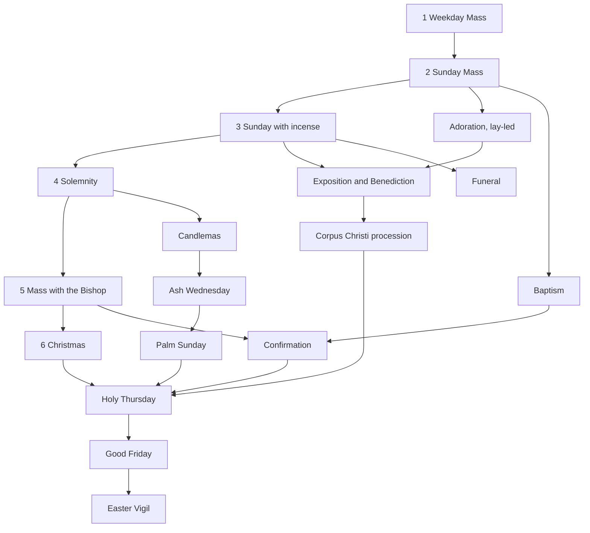

# Development guide and resume checklist

Read this first when starting a new session, human or AI. It explains how to
pick up the work, the current status, and the steps each change goes through.
What the product must do is specified in [`SPEC.md`](SPEC.md).

## Start-of-session checklist

- [ ] Read `docs/SPEC.md`, then this file, then the last round in
      `docs/GAME-DECISIONS.md`. The next decision number is in
      [Status](#status).
- [ ] Run `git fetch` and check open PRs (`gh pr list`) and issues
      (`gh issue list`). Merge `origin/main` into your branch if it moved.
- [ ] Run the four tests (below) to confirm a green baseline before editing.
- [ ] Note the user's request verbatim. Record any interpretation of an
      ambiguous request as a decision.
- [ ] For liturgical or Catholic questions, consult the Magisterium MCP server
      before relying on a claim; cite its supporting sources and ask the user
      when they do not resolve an ambiguity.

## Per-change checklist

- [ ] Put pure rules in `mass-game-logic.js`, export them through
      `module.exports`, and test them in `mass-game.test.cjs`.
- [ ] For a new script, add its `<script>` tag in the right order and a
      `node --check` line in `.github/workflows/checks.yml`.
- [ ] Put any markup a script needs at startup **before** the script tags.
- [ ] When setup defaults change, bump `SETUP_VERSION` in `mass-game.js` and
      decide how older saves migrate.
- [ ] Run the tests:
      ```
      node mass-scenarios.test.cjs
      node mass-features.test.cjs
      node mass-assets.test.cjs
      node mass-game.test.cjs
      ```
- [ ] Play it through in a real browser via `file://`: no console errors, and
      the new behaviour seen working. Automated checks used puppeteer-core
      with Edge (headless) and screenshots; such harness scripts are not
      committed.
- [ ] Log decisions in `docs/GAME-DECISIONS.md` (`R<n>`: question, choice,
      alternatives, source). Cite GIRM paragraphs through magisterium.com
      links.
- [ ] Make changes on a topic branch and submit them through a pull request.
      Never commit directly to `main`; confirm CI is green on the PR.
- [ ] Update the README ("Play now" for players, the game section for
      details) and `docs/SOURCES.md` if sources changed.
- [ ] When committing on the topic branch, use the trailer
      `Co-authored-by: Copilot App <223556219+Copilot@users.noreply.github.com>`,
      then push and open the pull request.
- [ ] Update [Status](#status) below.

## Conventions and pitfalls

- Files are UTF-8 without BOM, with LF line endings (`.gitattributes`
  normalises them). On Windows, write files with
  `[IO.File]::WriteAllText(path, text, (New-Object Text.UTF8Encoding $false))`.
- Scripts are classic and share globals, so avoid accidental name clashes
  across files.
- `material()` in `mass-3d.js` is cached and shared. Clone a material before
  changing it per mesh.
- `mass-materials.js` applies finishes only to explicitly tagged meshes.
  Pass the optional surface kind to `box`/`cylinder`, or use `finishSurface`.
  Supply a new base material to `finishSurface` when changing a surface colour.
  Do not mutate cached textures or infer a finish from a colour. Texture
  providers are High-only and should return a cleanup function.
- Plan coordinates convert to world coordinates with `world([x,y])`
  (SCALE .025; plan x 500 is world 0).
- `mass-3d.css` styles `header span`. Panels placed inside the header must
  reset `color` and `font-size`.
- Audio pipeline: `prepare-audio.cjs`, then `generate-audio.py`, then
  `snapshot-audio.cjs`, which writes `audio/audio-manifest.js` and
  `audio/index.csv`. The README section "Pre-generated AI audio" has the
  details, and `mass-assets.test.cjs` checks the references.
- Never reproduce full copyrighted liturgical texts (SPEC C3).
- Don't stop desktop applications you did not start without asking the user.

## Status

The repository is `jddcef/mass-sim-liturgy`, renamed from
`roman-mass-explorer`. GitHub Pages serves `main` at
<https://jddcef.github.io/mass-sim-liturgy/>. Contributions use topic branches
and pull requests; do not commit directly to `main`. Consult the Magisterium MCP
server for liturgical or Catholic questions and clarifications.

**Next decision number: R204.**

| Round | PR | Content |
|---|---|---|
| 1 | #2 | Playable simulator: roles, four levels, options, lapses, M.C., sacristan, bells and thurible |
| 2–3 | #3 | Watch mode, symbols, varied heights, incensation detail, cross and crucifix placement, outfits, liturgical colours, redo, windows and floor |
| 4 | #4 | Recorded audio in the game, homily place, collection, EMHC, reserved hosts, readers, timeline jump, speed slider |
| 5 | #5 | Role card, side quests, camera pad, speaker view, highlight, first person, sacristan training, audio fixes |
| 6 | #6 | Cupboard models, vestment rail and stand, first-person views, figure eyes |
| 7 | #7 | Presets, role switching, screen operator, monstrance, detail levels, sound icon, cancel New game |
| 8 | #8 | Search and index card, hover tips, feedback, wall fade, nave seating, audio timing, rename |
| docs | #8 | Player-facing README opening, `SPEC.md`, this guide, Copilot instructions |
| 9 | (this PR) | More natural bell synthesis, compact phone layout with fold-away menus |
| 10 | local, not published | Offline stone/marble/wood textures and metal finishes on Standard/High, reversible detail switching, restrained lighting; existing defaults and saved choices retained |
| 11 | local, not published | Repository workflow guidance: changes go through PRs rather than direct commits to `main`; consult the Magisterium MCP for liturgical and Catholic questions |
| 12 | local, not published | The Path and seniority: Involvement rename, Sunday split into with and without incense, a liturgical-year map of celebrations with marks and ranks, roadmap of rites "in preparation" |
| 27 | #21 | Good Friday (Celebration of the Passion of the Lord): silent entrance and prostration before bare altar; Collect without *Oremus*; Passion of St John in parts; ten Solemn Intercessions; Showing and Adoration of the Holy Cross (*Ecce lignum Crucis*); Communion from reserved Sacrament; Prayer over the People; silent departure; no Gloria, Creed, bells, or Eucharistic Prayer (R195–R201) |
| 28 | local, not published | Speaker-perspective look-around via drag and camera pad; continuous collection route joining the offertory presentation while keeping collection away from altar (R202–R203) |
| 26 | #21 | Holy Thursday (Evening Mass of the Lord's Supper): Gloria with bells followed by liturgical silence; Mandatum (washing of the feet); Creed strictly omitted; EP I Roman Canon with proper Communicantes, Hanc igitur, and Qui pridie; no consecration bells; transfer of the Blessed Sacrament to Altar of Repose with humeral veil and Pange Lingua; stripping of the altar (Denudatio altaris) in silence without final blessing or dismissal (R188–R194) |
| 25 | local, not published | Liturgical Season Ribbon & Mini-Breviary sheet (feast rank, Latin vestment colours with GIRM 346 rationales, Ordo Missae and rubrics), and Visual Chime & Thurible Ripples on HUD and 3D floor (R182–R187) |
| 24 | #21 | Palm Sunday: blessing of palms at the back of the church, procession with palm branches, no Penitential Act or Gloria; the Passion read in parts at the ambo without candles or incense; all genuflect at the death of the Lord; Creed is said (R175–R181) |
| 23 | #20 | Funerals: the Funeral Mass (reception of the body at the door with holy water and the white pall, violet, no Gloria or Creed, final commendation with incense and the Song of Farewell, "In paradisum") and the funeral liturgy outside Mass with the Priest or the Deacon; coffin on a bier, paschal candle, holy-water stand; new Path branch "The rites for the dead" (R168–R174) |
| 22 | #18 | Baptism of children within Sunday Mass (reception at the door, rite at the font after the Homily, Solemn Blessing) and outside Mass with the Priest or the Deacon; font, paschal candle, oils, white garment and candle; new Path branch "Christian initiation" (R161–R167) |
| 21 | #17 | Ash Wednesday: no Penitential Act, Gloria, Creed or Alleluia; after the Homily the Priest blesses and sprinkles the ashes and gives them to the faithful, who come forward in a line; the Deacon or a server holds the vessel (R154–R160) |
| 20 | #16 | Candlemas: blessing of candles at the back of the church, procession with lighted candles and the Canticle of Simeon, no Penitential Act, candles out at the Gloria (R147–R153) |
| 19 | #15 | Christmas Mass during the Night: the Christmas Proclamation before Mass, all genuflect at the Incarnation, the crib in the nave blessed at the universal prayer, Christmas solemn blessing; the M.C. rank becomes reachable (R137–R146) |
| 18 | #14 | Confirmation within Mass: candidate and sponsor, presentation, renewal of promises, laying on of hands, anointing with chrism, no Creed, Confirmation blessing (R127–R136) |
| 17 | #13 | Mass with the Bishop: mitre- and crozier-bearers in vimps, mitre and pastoral staff in 3D, homily at the cathedra, pontifical blessing (R119–R126) |
| 16 | #12 | Exposition and Benediction by a Deacon; white cope and humeral veil in 3D (R115–R118) |
| 14 | #10 | Rite registry; lay-led Adoration and Exposition and Benediction with the Priest (R104–R110) |
| 13 | local, not published | Generic prepared-shell parish profiles and maintainer editor: local library/draft, plan and 3D route preview, full-profile JSON export/import, seating/target integration and simple exterior; future user patch workflow reserved |
| 15 | local, not published | Parish source intake: agent runbook, `parishes/` manifest and spec formats, Street View screening, draft profiles, offline bulk reviewer (R111–R114) |

Round 10 was exercised in Edge through `file://` on all three pages, including
all sanctuary floors, repeated quality switches, layouts, appearance changes,
wall fading, first-person material clones and a complete accelerated Sacristan
Watch run (opening, setup, Mass and pack-away). Browser checks reported no
console errors or external requests; texture/material counts stayed constant
after warming and repeating the quality/floor combinations. This is not a
performance claim for physical low-spec hardware. Simulated low-memory mobile
startup selected Auto/Low and created no surface textures, finish-material
variants or reflection environment. All script syntax checks and all four
Node suites pass on Node 22. No commit, push or PR was requested, so remote CI
has not been run for this change.

Round 12 was exercised in Edge headless through `file://`: the Path opens
from setup and from the summary, "Prepare this celebration" sets the preset,
a credited game updates the mark, the rank strip and the recommendation, Esc
closes the Path, and at 390 px the list replaces the map. No console errors.
All four Node suites pass. Not committed or pushed.

Round 13 keeps the Legacy layout as the initial default and does not change
existing setup, layout, score or Path storage keys. `mass-parishes.js` supplies
pure profile validation, reversible seating coordinates and nave aisle routing;
`mass-parish-editor.js` supplies maintainer authoring on both 3D pages. Profiles
are strict versioned data for the fixed `rectangular-v1` shell, not arbitrary
surveyed churches. `bundled` in `mass-parishes.js` is the maintainer-reviewed
published profile list. New photographic/model assets require separate
preparation and rights review.

File-protocol browser checks in an isolated, self-exiting headless Edge instance
covered draft preview/cancel, furniture and seating mapping, the exterior and
animated route marker, working-copy persistence, full-profile export shape and
import, rejected unsupported/oversize files, explicit storage failures,
multiple-church selection, reload, Low/Standard/High switching, shifted-door
placement, expert picking for a moved ambo, editing guards, phone-width layout
and a complete accelerated Sacristan Watch run including opening and pack-away.
The browser harness advanced the Mass clock through its normal stop limits and
rendered walkers explicitly to avoid virtual-time frame throttling. Expected
validation/storage errors were checked separately; there were no unexpected
console errors or external page requests. All four Node suites and script
syntax checks pass. Direct `file://` startup also passed without a file-access
override; a cold Low startup created no surface textures with the profile shell
enabled. There is no physical low-spec performance claim, and no
real parish has yet been surveyed or recreated. Changes are local and
uncommitted; no push, PR or remote CI run was requested.

Round 15 adds parish source intake (R111–R114). `docs/PARISH-INTAKE.md` is a
runbook for an agent that prepares per-parish folders under `parishes/`, made
up of a source manifest with statuses and reason codes, and a parish spec with
per-value source and confidence. The agent screens Street View images with a
bearing rule and a visual check, and builds a review queue. `parish-intake.cjs`
(using `parish-intake.js`) provides the template, check, aim, draft, index and
apply commands. `parish-review.html` is the offline bulk reviewer. The
`mass-assets` suite covers formats, the bearing rule, draft conversion and a
full CLI round trip in a temporary folder. The reviewer was checked in headless
Edge through `file://` with sample data. It covered the contact sheet,
one-by-one mode, Ctrl+Enter accept with comment, R reject, auto-advance, skip
back to the sheet and saved decisions. All four Node suites pass. No real
parish material has been processed yet. The work is local and uncommitted.

Round 28 adds look-around controls to the temporary speaker-perspective camera
and connects the usher's collection route continuously from the nave to the
offertory presentation. The collection remains off the altar (GIRM 73, 140).
All four Node test suites and edited-script syntax checks pass. A headless Edge
load through `file://` initialized the scene, but interactive camera movement
was not automated. Changes are local and uncommitted.

### Open items and backlog

- [ ] Issue #1: regenerate the congregation audio with the four-voice mix.
- [ ] Owner: create a Formspree or Basin form and set `FEEDBACK_ENDPOINT` in
      `feedback-config.js`.
- [ ] Owner review of judgement calls in `GAME-DECISIONS.md`, especially
      R77 (reading of "nave without side aisles").
- [ ] Latin audio pack is partial.
- [ ] Roadmap for the Path (R96, R97). The celebrations are already on the map
      as "In preparation"; adding a `preset` to a celebration in
      `CELEBRATIONS` makes it playable and creditable.
      1. ~~Rite registry~~ done in round 14 (`RITES` in `mass-scenarios.js`).
      2. ~~Exposition and Benediction~~ done in round 14
         (`mass-rite-exposition.js`); the Deacon form, cope and humeral
         veil in round 16.
      3. ~~Mass with the Bishop~~ done in round 17 (mitre- and
         crozier-bearers in vimps; R119–R126); ~~Confirmation~~ in round 18
         (R127–R136).
      4. ~~Christmas Mass during the Night~~ done in round 19 (R137–R146);
         ~~Candlemas~~ in round 20 (R147–R153, indoor form only);
         ~~Ash Wednesday~~ in round 21 (R154–R160);
         ~~Palm Sunday~~ in round 24 (R175–R181).
      5. Corpus Christi: an outdoor procession (canopy, torches, petals,
         Benediction at altars), which needs an outdoor scene.
      6. The Triduum: ~~Holy Thursday~~ done in round 26 (R188–R194);
         ~~Good Friday~~ done in round 27 (R195–R201); the Easter Vigil.
      7. ~~Baptism of children~~ done in round 22 (within Mass and outside
         Mass with the Priest or Deacon; R161–R167).
      8. ~~Funerals~~ done in round 23 (Funeral Mass and the funeral
         liturgy outside Mass; R168–R174). The Vigil and the Rite of
         Committal (outdoors) are left for later.
      9. Later: Vespers with Benediction, weddings.


- [x] Local surface textures on Standard and High (round 10); Low stays
      untextured and the High-only extension hook remains available.
- [ ] Future: a full first-person mode for every role, extending today's
      first person with hints.
- [ ] Parish pilot: collect one rights-cleared reference pack and measured/
      estimated floor sketch; review a block model before adding custom
      shell geometry, levels or irregular routing. The current template does
      not prove every sanctuary movement is collision-free.
- [ ] Parish intake (round 15): run the `docs/PARISH-INTAKE.md` agent over
      the owner's material, review in `parish-review.html`, and apply the
      decisions. Then extend the shell for spec fields that only reach the
      report today: left/behind sacristy, cruciform or apsed plans, belfry
      and roof pitch.
- [ ] Later parish contributions: reviewed patch export/import using stable
      object IDs, base revision and expected old values; no automatic upload
      or patch merge exists yet. Full-profile JSON is the current handoff.
